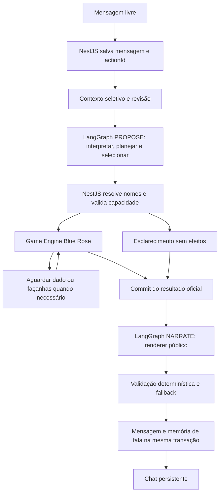

# Mestre narrativo — Fase 5.4

01/11/2026. Implementado o caminho de linguagem livre; a fase integral permanece em validação. Testes simulados não certificam interpretação real nem uma campanha inteira sem operador. [Evidências e pendências](../testing/phase-5.4-validation.md), [decisão](../adr/0007-intencoes-livres-e-falas-atribuidas.md).

O grafo conserva os nós `interpret_and_propose` e `narrate_confirmed`: interpretação/plano/ferramenta compartilham uma chamada, e o NestJS guarda checkpoints, leases e a execução entre as duas etapas. Python continua sem banco, SQL, shell ou ferramentas administrativas. Não há agentes independentes, filas ou memória paralela.

`POST actions` continua aceitando apenas `actionId`, modo, conteúdo e escolhas explícitas opcionais. Sem opção selecionada, uma proposta `FREE` pode conversar, observar, consultar informações, pedir esclarecimento ou solicitar uma capacidade delimitada. [Contratos](free-action-interpreter.md), [ferramentas](tool-selection.md), [renderer](narrative-renderer.md).

Nomes precisam corresponder univocamente a personagens presentes/conhecidos, indivíduos de Story Cards da cena, objetos públicos recuperados ou itens do inventário. Arquétipos não viram indivíduos. UUIDs de cast são derivados pelo servidor no namespace já existente. Um alvo desconhecido não é criado nem exposto numa pergunta. Perguntas livres do planner não são publicadas: o backend escolhe o esclarecimento para impedir que contexto GM vire spoiler.

Falas livres geram eventos explicitamente atribuídos, sem provar acordo, persuasão, verdade ou confiança. Conhecimento e réplicas usam as tabelas existentes e sobrevivem ao encerramento. OOC/THINK não geram essas associações. A resposta de um NPC recebe personalidade, motivação pública, estado, voz e suas próprias lembranças; não recebe segredos de referência, memórias da protagonista ou de outro NPC. Relacionamentos mostram somente métricas originadas no interlocutor, sem transportar motivos privados.

O Director mantém os critérios anteriores: diálogo novo não conclui opções, objetivos ou capítulos. Duração não encerra a sessão. Caminhos sem automação conservam adjudicação segura; não há teletransporte de pistas, reimportação de campanha, edição de ficha ou migração de Gloamhale v1/v2.

Uma conversa normal pode usar duas chamadas: interpretação e resposta literária após commit. Esclarecimentos, pensamento e adjudicação usam resposta determinística na etapa final. Opções explícitas legadas conservam a projeção exata. `ai_usage` registra ambas as etapas, tokens reportados, latência, erros, caracteres e agregação por turno/sessão. Provedor gratuito confirmado é requisito; não há estimativa financeira confiável quando o provedor não informa uso.

As mudanças são locais, sem implantação no banco real. A configuração financeira normal permanece desativada. A [avaliação autorizada](narrative-evaluation.md#resultado-real-e-revisão-técnica) usou 10 das 11 chamadas aprovadas. Continuidade passou no validador real, mas seleção de ferramentas e fundamentação tiveram reprovações; qualquer novo experimento exige orçamento próprio. Nenhuma Fase 6 foi iniciada.
