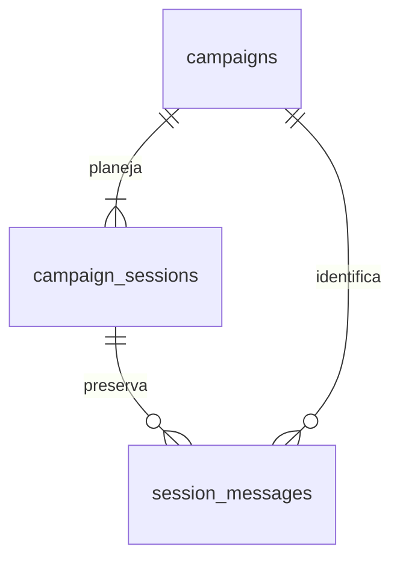

# Campanhas, sessões e chat persistente — Fase 2

O [documento-base](../base-projeto.md) continua sendo a visão principal. A
[ADR 0003](../adr/0003-dominio-de-campanhas-e-sessoes.md) registra o recorte desta fase.
NestJS é a autoridade; PostgreSQL é a fonte de verdade. Next.js usa o proxy de mesma
origem `/api/v1/*`. O serviço Python continua disponível para diagnóstico, mas nenhum
fluxo desta fase depende dele nem chama um provedor de IA.

## Módulos e contratos

- `apps/api/src/campaigns`: controller, DTOs de entrada/saída, service e repository.
- `apps/api/src/sessions`: lifecycle, cronômetro, controller, DTOs, service e repository.
- `apps/api/src/messages`: envio de mensagens da jogadora, consulta paginada e DTOs.
- `apps/api/src/database/schema.ts`: schema Drizzle, enums, índices e constraints.
- `packages/shared-contracts/src/index.ts`: tipos públicos e enums consumidos pelo web.
- `packages/shared-contracts/openapi/api.json`: contrato Swagger gerado/versionado.

Controllers só encaminham parâmetros validados aos services. Regras de negócio
ficam nos services e em `session-state.ts`; queries e locks ficam nos repositories.
As transações de lifecycle e mensagens são orquestradas pelos services. A criação
persiste campanha e planejamento em uma única transação no repository.

A dependência é acíclica: Sessions importa Campaigns; Messages importa ambos.
Cada módulo exporta apenas o repository necessário aos outros. Não há camada genérica
de CRUD, armazenamento permanente em memória ou dependência do navegador para persistir.
Os DTOs de resposta selecionam explicitamente os campos; futuros campos privados não
serão automaticamente incluídos no JSON público. Swagger descreve entradas e saídas.

## Modelo de dados



| Tabela              | Campos e invariantes                                                                                                                                                                        |
| ------------------- | ------------------------------------------------------------------------------------------------------------------------------------------------------------------------------------------- |
| `campaigns`         | UUID; título; descrição anulável; sessões planejadas (8); duração padrão em minutos (120); sessão atual anulável; `DRAFT`, `ACTIVE`, `COMPLETED`; timestamps e conclusão                    |
| `campaign_sessions` | UUID; campanha; número a partir de 1; título; descrição; estado; duração estimada; segundos ativos acumulados; início, retomada, pausa e conclusão; tipo de encerramento e resumo anuláveis |
| `session_messages`  | UUID; campanha; sessão; role; modo; conteúdo; sequência; JSONB `metadata`; criação                                                                                                          |

- `UNIQUE(campaign_id, session_number)` impede duplicação do planejamento.
- Índice único parcial por campanha para estados `IN_PROGRESS` ou `PAUSED` impede
  duas sessões abertas simultaneamente, inclusive por SQL fora da API.
- `UNIQUE(id, campaign_id)` nas sessões permite FK composta das mensagens.
- FK `(session_id, campaign_id)` garante que a sessão da mensagem pertence à campanha.
- `UNIQUE(session_id, sequence_number)` dá uma ordem determinística e serve de índice
  para leitura e busca da última sequência; há índice de mensagens por campanha/data.
- Checks exigem números positivos, tempo não negativo, conteúdo/título não vazios,
  `resumed_at` somente em andamento e dados de conclusão quando concluída.
- UUIDs são gerados no PostgreSQL; timestamps usam `timestamptz`. Os repositories
  atualizam `updated_at` explicitamente. Não há atualização automática por trigger.
- FKs usam `RESTRICT`, sem apagar chats em cascata. Não existem endpoints públicos
  para excluir campanha/sessão/mensagem, editar mensagens ou reabrir sessões.

`0001_campaigns_sessions_messages.sql` é aditiva e acompanha snapshot/journal Drizzle.
A migração inicial `0000_enable_vector.sql` permanece preservada.

## Planejamento e transições

Criação: campanha `DRAFT`, sessão atual nula, todas as sessões planejadas inseridas
na mesma transação. Somente a primeira fica `AVAILABLE`; as demais são `LOCKED`.
Títulos iniciais são apenas “Sessão N”; não há narrativa ou resumo inventado.

```text
LOCKED → AVAILABLE → IN_PROGRESS ↔ PAUSED
                         ↓           ↓
                      COMPLETED ←────┘
```

| Ação     | Pré-condição                                                   | Efeito atômico                                                                            |
| -------- | -------------------------------------------------------------- | ----------------------------------------------------------------------------------------- |
| start    | `AVAILABLE`, anterior concluída, nenhuma sessão aberta/pausada | `IN_PROGRESS`, início/retomada, campanha `ACTIVE`, sessão atual atualizada                |
| pause    | `IN_PROGRESS`                                                  | Acumula intervalo ativo, limpa retomada, define pausa e `PAUSED`                          |
| resume   | `PAUSED`                                                       | Novo marco de retomada, limpa pausa, preserva tempo e mensagens                           |
| complete | `IN_PROGRESS` ou `PAUSED`, motivo válido                       | Acumula intervalo restante, define conclusão, limpa retomada e libera a próxima planejada |

A última conclusão marca a campanha `COMPLETED`, registra `completedAt` e mantém
`currentSessionNumber` apontando para a última sessão jogada. Nenhuma sessão é criada
ou iniciada automaticamente no encerramento. Consultar um chat antigo não altera a
sessão atual. O resumo permanece nulo. `endingType` registra uma escolha explícita,
sem validar objetivos narrativos nesta fase.

A duração estimada é orientação, sem término automático. Tempo ativo é o acumulado
mais o intervalo entre `resumedAt` e o instante atual, somente em `IN_PROGRESS`.
Persistimos segundos inteiros: frações menores que um segundo são truncadas a cada
pausa/encerramento. Deltas negativos são tratados como zero. O relógio do backend é
a autoridade. A resposta inclui o total `activeDurationSeconds` medido em
`timeMeasuredAt`; o cliente apenas anima esse valor até a próxima leitura.

**Nesta fase, fechar o navegador ou desconectar não pausa automaticamente.** A
sessão continua em andamento até pausa/encerramento explícito, inclusive durante
reinícios. Detecção de inatividade/heartbeat é decisão futura do documento-base.

## Concorrência e repetição

Todas as escritas em sessões/mensagens começam pela campanha (`SELECT ... FOR
UPDATE`) e depois pela sessão. A ordem é sempre campanha → sessão, inclusive no
envio de mensagens: inserts de mensagens adquirem locks implícitos para validar
as FKs; inverter a ordem poderia gerar deadlock com o encerramento.

Sob os locks e na mesma transação, o service relê o estado antes de autorizar uma
mudança. A sequência é a última sequência indexada + 1, **somente após adquirir os
locks**, e o insert ocorre antes do commit. Não há `MAX + 1` desprotegido. Mensagens
na mesma campanha são serializadas; campanhas diferentes podem escrever em paralelo.
Um envio vence o lock e é confirmado antes do encerramento, ou encontra `COMPLETED`
e retorna `409`. Não existe janela entre verificar o estado e inserir.

Política de lifecycle: toda transição cuja pré-condição já não vale retorna `409`,
inclusive uma repetição imediata. Assim, dois starts/completes simultâneos produzem
um sucesso e um conflito. O tempo não é somado novamente. Uma retomada posterior a
uma nova pausa é uma nova transição válida; não há chave de idempotência histórica.
POST de mensagem cria uma nova mensagem a cada requisição válida; não faz retry
automático. Idempotência de ações futuras permanece fora deste recorte.

As constraints funcionam como segunda barreira de integridade. Listar os detalhes
com sessões usa uma transação `REPEATABLE READ` para obter uma visão consistente.

## Histórico e paginação

`GET .../messages?after=0&limit=50` lê do início. `after` é exclusivo e local à sessão;
`limit` aceita 1–100. A consulta ordena por `sequenceNumber ASC`, lê `limit + 1` e
retorna `{ data, nextCursor, hasMore }`. Enquanto `hasMore`, o próximo request usa
`after=nextCursor`; no fim, `nextCursor=null`. IDs e timestamps não são cursores.
É possível recuperar integralmente uma sessão de qualquer estado. Novas mensagens
podem ser buscadas usando a última sequência conhecida, mesmo após uma página final.

A UI apresenta o início do histórico com “Carregar próximas mensagens”, sem
substituir mensagens antigas. Depois de enviar em um histórico parcialmente carregado,
busca as páginas restantes para mostrar a mensagem confirmada sem lacunas. Ao concluir,
a tela apresenta título e tempo reais, acesso ao histórico e início explícito da
próxima sessão. Na última sessão mostra a conclusão da campanha. A sessão concluída
mantém o formulário desabilitado; a API também rejeita envio com `409`.

## Validação, erros e limites

ValidationPipe transforma DTOs e rejeita propriedades desconhecidas. UUIDs inválidos
retornam `400`; sessão fora da campanha retorna `404`. Apenas `title` e `description`
podem ser editados na campanha. Título tem 1–200 caracteres após trim; descrição,
até 10.000. Planejamento aceita 1–1000 sessões e duração 1–10.080 minutos para
limitar o tamanho da criação transacional. Defaults são 8 e 120.

O payload de mensagem aceita somente conteúdo não branco e `interactionMode`; a API
fixa `role=PLAYER`. `MESSAGE_MAX_LENGTH` configura o limite (padrão 10.000, de 1 a
100.000). A UI limita a 10.000; limites menores configurados são validados pela API.
Não se pode forjar role ou metadados no endpoint da jogadora. Conteúdo é texto React,
sem renderização HTML. Falhas internas retornam mensagem genérica; logs não imprimem
SQL, parâmetros ou conteúdo do chat. CORS preserva a lista explícita de origens e
permite GET/POST/PATCH. Não há autenticação nesta fase, conforme a tarefa.

## Testes e operação

`pnpm test` executa unidades/HTTP sem banco real. `pnpm test:integration` inicia um
PostgreSQL real exclusivo, aplica migrations duas vezes (reexecução segura), executa
unidades + integração e remove somente o container/volume de teste ao terminar.
`pnpm --filter @solo-rpg/api test:coverage` usa o mesmo ambiente com cobertura e
limiares globais de 80%. Docker e permissão para sockets locais são necessários.
Nenhuma variável de teste aponta para o banco de desenvolvimento; credenciais são
geradas por execução e não são impressas.

Cobertura funcional: planejamento/defaults, validação, edição, rollback com falha
injetada, transições e conflitos, cronômetro sem pausas, conclusão da campanha,
isolamento, ordenação, paginação integral, 20 envios concorrentes, start/complete
duplicados e envio concorrente com complete. O cenário de persistência envia 5 + 3
mensagens na primeira sessão, inicia e escreve na segunda, reinicia API e PostgreSQL
e compara todos os registros e sequências originais. As FKs/uniqueness são testadas
por SQL no banco isolado.

Para liberar a mudança: aplicar migrations → API → web. A mudança é aditiva;
consumidores de health continuam compatíveis. Reverter os binários à Fase 1 deixa as
tabelas e os registros preservados. Não existe down destrutivo automatizado: para
retomar, reaplicar os binários da Fase 2. Não remover tabelas nem o volume para fazer
rollback. Antes de qualquer operação de manutenção sobre dados reais, usar backup
PostgreSQL e verificar restauração. O volume nomeado sobrevive a recriações de
containers; `docker compose down -v` remove dados e não é usado pelos scripts.

## Próxima fase

Adicionar Game Engine, personagens, estado do mundo e eventos por módulos próprios.
UUIDs, JSONB e relações explícitas permitem novas tabelas sem remodelar o histórico.
Proprietários poderão ser adicionados à campanha no futuro; não há usuário fictício
nesta fase. Metadados, roles e resumo têm lugar reservado, mas memória narrativa e
resumos derivados deverão coexistir com a transcrição, sem substituí-la. `FINALIZING`,
Director e integrações de IA só serão adicionados quando suas responsabilidades
existirem; não há estruturas simuladas dessas funcionalidades agora.
