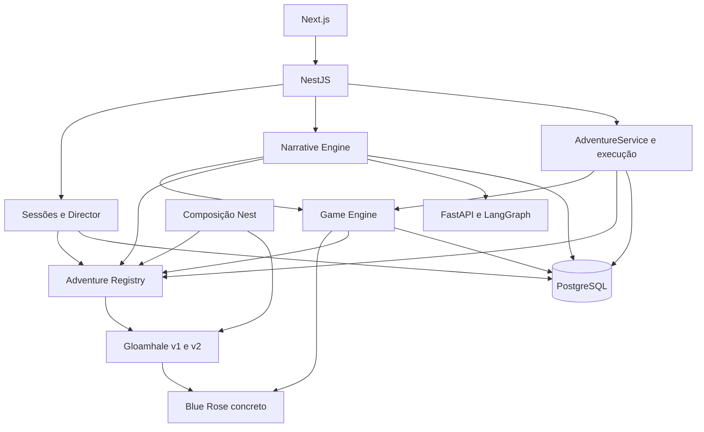

# Mapa de dependências — Fase 5.1

`AdventureRegistryModule` é uma composição folha: não importa GameEngineModule ou SessionsModule. `GameEngineModule` importa sessões e Blue Rose como antes; sessões e narrativa recebem o registro diretamente. Conteúdo importa somente tipos do contexto/commandos do Game Engine e regras oficiais; não injeta GameEngineService no registro. O boot real Nest e os testes de fronteiras verificam esse arranjo sem `forwardRef`.

Persistência importa tipos de definição, sem importar módulos concretos ou codecs da mansão. Blue Rose usa contexto transacional e tabelas oficiais, sem consulta a aventuras. `state.ts` recebe o registro para metadados de finais; não conhece nomes de encontros. O alias de IMPORT e namespace histórico estão centralizados em `default-adventure.ts`, exclusivamente para compatibilidade.

As definições em `registry.ts` dependem de tipos de estado/DB, mas esses imports são `type` e desaparecem em runtime. Isso não introduz ciclo de injeção Nest. FastAPI não recebe conexão PostgreSQL; sua dependência externa é o provedor configurado. Não foram introduzidos serviços, bibliotecas ou abstrações para outros sistemas de RPG.

Verificação: `test/architecture-boundaries.spec.ts` impede imports de aventura em Blue Rose e referências concretas em registro, importador, Game Engine, sessões e narrativa. O teste de integração registra conteúdo fictício original sem alterar código de produção ou Gloamhale e exercita duas sessões com os mesmos endpoints.

## Incremento 5.5

Campaigns → AdventureRegistry + importAdventure → PostgreSQL cria unidades da definição na transação de campanha. Sessions → directorState → avaliador de condições; Narrative → projeção pública do mesmo Director. O catálogo de menções lê estado autorizado e alimenta FREE; o composer não inventa entidades. Helpers de identidade foram isolados em identity.ts e reexportados por state.ts para preservar consumidores. Gloamhale v3 só entra pela composição, sem imports concretos no avaliador/motor.
